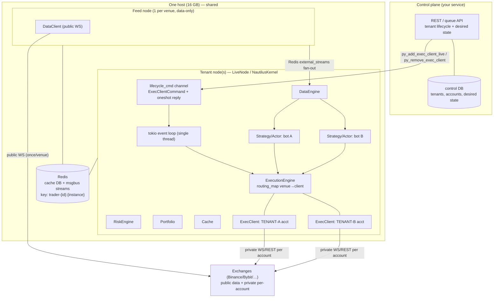
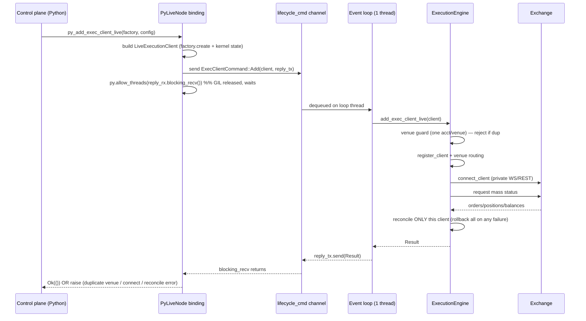
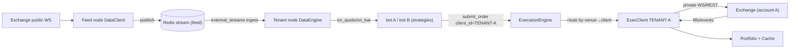

# Trade-engine-as-a-service — architecture & data flow

Target: many tenants (each their own exchange account) sharing host + infra, with
**runtime add/remove of execution clients** on a live node (feature
`feature/runtime-multi-account-node`) so a new tenant joins without restarting the node.

## 1. High-level components

Key points:
- **One `NautilusKernel` per node**, single-threaded event loop. ~131 MB fixed/node; bots ≈ tens of KB each → pack many bots + accounts per node.
- **Shared**: host, Redis (logical isolation by `trader_id` key prefix), market-data feed (one public WS/venue, fanned out via Redis `external_streams`).
- **Per-tenant**: exec client + venue API creds (2+ accounts per venue allowed as of v2, routed by explicit `client_id`), strategy/bot state.
- **Runtime lifecycle** (this feature): control plane calls `py_add_exec_client_live(factory, config)` / `py_remove_exec_client(client_id)`; the call enqueues an `ExecClientCommand` on the live-crate channel and **blocks on a oneshot reply** so the real success/failure (incl. connect/reconcile/duplicate-venue) comes back synchronously.

## 2. Runtime add/remove data flow (the feature)

Remove mirrors this: `Remove(client_id, reply_tx)` → disconnect → deregister → drop from `exec_clients` (orders/positions left in cache as-is) → reply.

## 3. Market-data + order flow (steady state)

Isolation: cache/portfolio/orders keyed by `trader_id` + per-account `account_id`. **v2 (shipped):** two tenants on the *same* venue in one node are fully isolated — orders carry explicit `client_id`/`account_id`; RiskEngine pre-trade and Portfolio reads resolve per account; the venue→account fallback is kept but fail-closed (returns the single account, or `None` when 2+, never a wrong one). Adding a 2nd same-venue account is allowed; the only remaining uniqueness constraint is `client_id`.
